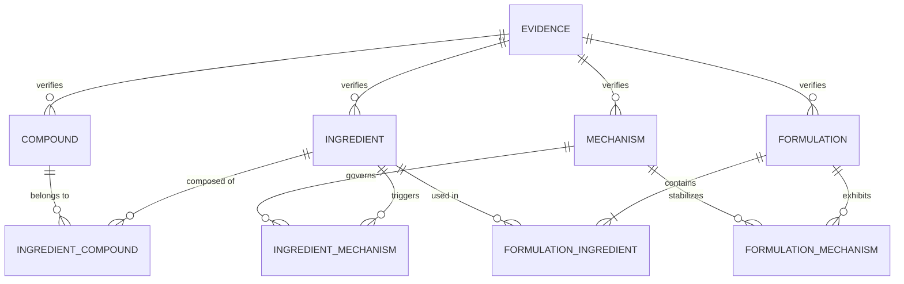

# FOODMECHANICS — Data Dictionary & Knowledge Model

## 1. Overview & Architectural Integrity

The FOODMECHANICS knowledge model bridges nutritional biology, molecular food chemistry, and culinary physics. Every record adheres to the following foundational contracts:
1. **Serving Basis Normalization Contract:** All nutritional metrics across all ingredients and products are strictly normalized to a **100.0g basis**.
2. **Provenance & Evidence Contract:** Every entity, functional assertion, and mechanism edge preserves an `EvidenceRecord` attributing the fact to a USDA FDC ID, PubChem CID, UniProt accession, or peer-reviewed DOI.
3. **Reproducible Physical Units:** All temperatures are expressed in Celsius (°C), molecular masses in Daltons (Da) or g/mol, surface tensions in mN/m, time in minutes (min), and rheological yield stresses in Pascals (Pa).



---

## 2. Entity: `ingredients`

Represents core culinary ingredients, raw materials, hydrocolloids, and liquid food matrices.

| Field | Type | Nullable | Units | Description & Scientific Constraints |
|---|---|---|---|---|
| `id` | string (PK) | No | - | Unique ingredient identifier (e.g. `ing_egg_white_raw`, `ing_heavy_cream`) |
| `common_name` | string | No | - | Standard culinary and commerce name |
| `scientific_name` | string | Yes | - | Taxonomic or chemical descriptor (e.g. *Gallus gallus albumen*) |
| `category` | string | No | - | High-level food group (e.g. Dairy, Poultry & Egg, Hydrocolloids, Sweeteners) |
| `physical_state` | string | No | - | Physical appearance at 20°C: `Liquid colloid`, `Solid powder`, `Emulsion`, `Crystalline solid` |
| `density_g_per_ml` | float | No | g/mL | True fluid or bulk tap density at 20°C (e.g. `1.035` for egg white) |
| `volume_conversions` | map<string, float> | Yes | grams (g) | Physical mass conversions for common culinary volumetric measures (1 tbsp, 1 cup) |
| `nutritional_profile_per_100g` | struct | No | per 100g | Standardized macronutrient and micronutrient composition strictly per 100g mass |
| `nutritional_profile_per_100g.energy_kcal` | float | No | kcal | Caloric energy |
| `nutritional_profile_per_100g.water_g` | float | No | g | Moisture content |
| `nutritional_profile_per_100g.protein_g` | float | No | g | Crude protein content (Kjeldahl or Dumas N factor) |
| `nutritional_profile_per_100g.total_fat_g` | float | No | g | Total lipid content |
| `nutritional_profile_per_100g.saturated_fat_g`| float | No | g | Saturated fatty acids |
| `nutritional_profile_per_100g.carbohydrates_g`| float | No | g | Available carbohydrate by difference |
| `nutritional_profile_per_100g.sugars_g` | float | No | g | Free mono- and disaccharides |
| `nutritional_profile_per_100g.dietary_fiber_g`| float | No | g | Total dietary fiber |
| `nutritional_profile_per_100g.sodium_mg` | float | No | mg | Sodium mineral content |
| `nutritional_profile_per_100g.calcium_mg` | float | No | mg | Calcium mineral content |
| `nutritional_profile_per_100g.potassium_mg` | float | No | mg | Potassium mineral content |
| `functional_properties` | struct | No | - | Physical colloidal and interfacial mechanics |
| `functional_properties.foam_expansion_overrun_pct` | struct | No | % | Foam volume increase: `(V_foam - V_liquid) / V_liquid * 100` |
| `functional_properties.foam_stability_half_life_min` | float | No | minutes | Elapsed time for 50% of initial foam volume or liquid lamellae to drain |
| `functional_properties.drainage_rate_ml_per_10min` | float | No | mL/10min | Gravitational liquid drainage through Plateau borders under ambient conditions |
| `functional_properties.emulsion_capacity_g_oil_per_g_protein` | float | No | g oil / g | Maximum mass of neutral oil emulsified per gram of protein before phase inversion |
| `functional_properties.gelation_temperature_c` | struct | Yes | °C | Thermal transition points: onset, peak elastic modulus, and firm network formation |
| `functional_properties.heat_denaturation_threshold_c`| float | Yes | °C | Minimum temperature inducing irreversible tertiary structure unfolding |
| `functional_properties.isoelectric_point_ph` | float | Yes | pH | Point of zero net electrostatic charge (pI) |
| `functional_properties.ambient_ph` | float | No | pH | Native pH of the ingredient in aqueous solution at 20°C |
| `functional_properties.interfacial_tension_reduction_mn_m` | float | No | mN/m | Dynamic drop in air-water or oil-water interfacial tension upon equilibrium adsorption |
| `constituent_compounds` | array<struct> | No | - | Array of chemical components with mass fractions |
| `dominant_mechanisms` | array<string> | No | - | Array of mechanism IDs governed by this ingredient |
| `evidence` | struct | No | - | Mandatory evidence attribution record (see Section 6) |

---

## 3. Entity: `compounds`

Represents pure molecular species, proteins, glycoproteins, polysaccharides, and lipid classes.

| Field | Type | Nullable | Units | Description |
|---|---|---|---|---|
| `compound_id` | string (PK) | No | - | Unique chemical identifier (e.g. `comp_ovalbumin`, `comp_sucrose`) |
| `name` | string | No | - | Standard chemical / biochemical name |
| `formula` | string | Yes | - | Empirical molecular formula (e.g. `C12H22O11` for sucrose) |
| `molecular_weight_da` | float | No | Daltons (Da) | Molecular mass (e.g. 44,500 Da for ovalbumin, 342.3 Da for sucrose) |
| `cid` | integer | Yes | - | PubChem Compound Identification number |
| `uniprot_id` | string | Yes | - | UniProt accession code for proteins (e.g. `P01012`) |
| `structure_type` | string | No | - | Molecular architecture (e.g. Globular serpin, Colloidal micelle, Disaccharide) |
| `biological_source` | string | No | - | Natural organism or botanical/animal origin |
| `functional_classification` | string | No | - | Role: `STRUCTURAL_FOAMING_PROTEIN`, `VISCOSITY_BUILDER`, `EMULSIFIER`, `ACIDULANT`, `HYDROCOLLOID` |
| `solubility` | string | No | - | Aqueous solubility limits and pH/temperature dependence |
| `isoelectric_point` | float | Yes | pH | Isoelectric point (pI) |
| `denaturation_temp_c` | float | Yes | °C | Unfolding or melting temperature |
| `chemical_rationale` | string | No | - | Mechanistic rationale for interfacial and colloidal behavior |
| `evidence` | struct | No | - | Mandatory evidence attribution record |

---

## 4. Entity: `mechanisms`

Represents established food physical chemistry principles governing culinary structures.

| Field | Type | Nullable | Units | Description |
|---|---|---|---|---|
| `mechanism_id` | string (PK) | No | - | Unique mechanism identifier (e.g. `mech_protein_mechanical_denaturation`) |
| `title` | string | No | - | Full canonical name of the mechanism |
| `summary` | string | No | - | High-level 1-2 sentence description |
| `molecular_physics_rationale` | string | No | - | In-depth thermodynamic and kinetic explanation at molecular scales |
| `critical_factors` | map<string, string> | No | - | Key variables controlling the process (shear rate, pH, temperature, lipid purity) |
| `kinetics_and_thermodynamics` | map<string, string> | No | - | Time scales, surface pressures, and reversibility characteristics |
| `culinary_applications` | array<string> | No | - | Practical culinary preparations governed by this principle |
| `failure_modes` | array<string> | No | - | Specific culinary defects caused by disruption of this mechanism |
| `evidence` | struct | No | - | Mandatory evidence attribution record |

---

## 5. Entity: `formulation_comparisons`

Represents real-world culinary and food-tech formulations compared across foam physics metrics.

| Field | Type | Nullable | Units | Description |
|---|---|---|---|---|
| `formulation_id` | string (PK) | No | - | Identifier (e.g. `FORM-001`, `FORM-002`) |
| `title` | string | No | - | Formulation name |
| `category` | string | No | - | Foam classification (e.g. High-Overrun Protein Foam, Fat-Crystal Network) |
| `description` | string | No | - | Formulation scope and intent |
| `ingredients_formula` | array<struct> | No | - | Recipe components: `ingredient_id`, `mass_g`, `baker_percentage`, `role` |
| `target_attributes` | struct | No | - | Physical performance profile |
| `target_attributes.foam_expansion_overrun_pct` | float | No | % | Foam expansion percentage |
| `target_attributes.foam_stability_half_life_min`| float | No | min | Foam volume half-life |
| `target_attributes.drainage_rate_ml_per_10min` | float | No | mL/10min | Liquid drainage rate |
| `target_attributes.foam_density_g_ml` | float | No | g/mL | Bulk density of aerated structure |
| `target_attributes.bubble_size_d32_um` | float | No | micrometers | Sauter mean bubble diameter |
| `target_attributes.firmness_yield_stress_pa` | float | No | Pascals (Pa) | Dynamic yield stress before flow |
| `target_attributes.thermal_stability_c` | float | No | °C | Maximum temperature before network breakdown |
| `target_attributes.fat_sensitivity` | string | No | - | Tolerance to extraneous lipid contamination |
| `mechanism_interactions` | array<string> | No | - | Mechanism IDs cooperating in this formulation |
| `performance_tradeoffs` | string | No | - | Analysis of engineering and culinary compromises |
| `evidence` | struct | No | - | Mandatory evidence attribution record |

---

## 6. Provenance & Evidence Schema (`EvidenceRecord`)

Enforces `coordination/contracts/provider.py` and `coordination/INTEGRATION_CONTRACT.md`.

```json
{
  "source_id": "doi:10.1016/j.foodhyd.2005.03.014",
  "source_type": "scientific_lit",
  "source_url": "https://doi.org/10.1016/j.foodhyd.2005.03.014",
  "publication_date": "2006-03-01",
  "ingestion_timestamp": "2026-11-08T09:48:10Z",
  "extraction_timestamp": "2026-11-08T09:48:10Z",
  "evidence_confidence": "PEER_REVIEWED",
  "raw_payload_ref": "FOODMECHANICS/data/raw/scientific_lit/crossref_10_1016_j_foodhyd_2005_03_014_20261108_094810.json"
}
```

### 6.1 Permitted Values for `evidence_confidence`
- `PEER_REVIEWED`: Verified through peer-reviewed academic literature or official government food composition publications (USDA FDC, Crossref DOIs).
- `EMPIRICAL`: Measured directly via standardized culinary experimentation, laboratory instruments, or manufacturer test panels (e.g. Open Food Facts product labels).
- `HYPOTHESIS`: Theoretical thermodynamic or kinetic projection pending direct experimental confirmation.
- `ANNOUNCEMENT`: Commercial product launch specification or supplier technical datasheet.
- `EVALUATED`: Validated by internal multi-agent food chemistry evaluation suites.
