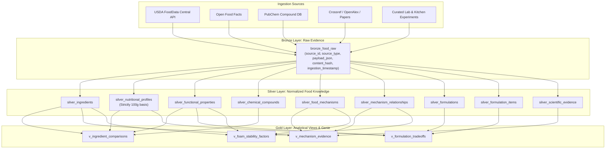
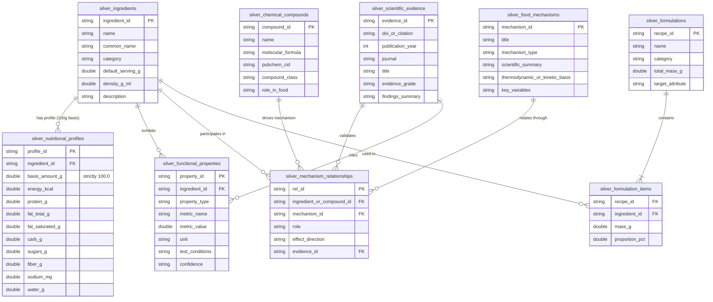

# FOODMECHANICS Data Schema Architecture

## 1. Architecture Overview & Medallion Design

FOODMECHANICS implements a Medallion Architecture (Bronze -> Silver -> Gold) designed to transform disparate food data—nutritional facts, biochemical compounds, functional culinary measurements, recipe formulations, and scientific publications—into a unified, queryable knowledge graph.

---

## 2. Medallion Table Specifications

### 2.1 Bronze Layer (Raw Capture)

The Bronze layer preserves verbatim payloads from all external APIs and raw experiment feeds. Ingestion is idempotent using SHA-256 hash deduplication.

#### Table: `bronze_food_raw`
*Primary storage for raw immutable JSON records.*

| Column | Type (DuckDB / SQL) | Type (Databricks) | Nullable | Description |
|---|---|---|---|---|
| `source_id` | `VARCHAR` | `STRING` | **NO** | Primary key. Unique upstream identifier (e.g., `usda_fdc:171234`, `pubchem:5988`, `doi:10.1016/j.foodhyd.2020.106450`). |
| `source_type` | `VARCHAR` | `STRING` | **NO** | Origin system: `usda_fdc`, `open_food_facts`, `pubchem`, `crossref`, `culinary_experiment`. |
| `payload_json` | `TEXT` | `STRING` | **NO** | Full, unaltered raw JSON payload from source. |
| `ingestion_timestamp`| `TIMESTAMP` | `TIMESTAMP` | **NO** | UTC timestamp when record entered the Bronze table. |
| `content_hash` | `VARCHAR(64)` | `STRING` | **NO** | SHA-256 hash of canonicalized `payload_json` for idempotent ingestion. |
| `source_url` | `VARCHAR` | `STRING` | YES | Canonical origin URL. |
| `batch_id` | `VARCHAR` | `STRING` | YES | Identifier of ingestion execution run. |

---

### 2.2 Silver Layer (Normalized Knowledge Graph)

The Silver layer enforces canonical entity identities, standardized physical units, strict **100g nutritional normalization**, relationship foreign keys, and complete provenance tracking.

#### 2.2.1 Table: `silver_ingredients`
*Catalog of canonical ingredients with baseline physical constants.*

| Column | Type | Constraints | Description |
|---|---|---|---|
| `ingredient_id` | `VARCHAR` | PRIMARY KEY | Unique snake_case identifier (e.g. `ing_egg_white`, `ing_heavy_cream`). |
| `name` | `VARCHAR` | NOT NULL | Standard scientific or culinary name. |
| `common_name` | `VARCHAR` | | Everyday culinary label. |
| `category` | `VARCHAR` | NOT NULL | Functional category: `egg_protein`, `dairy_fat`, `dairy_liquid`, `hydrocolloid`, `sweetener`, `acidulant`, `plant_protein`. |
| `default_serving_g` | `DOUBLE` | NOT NULL | Typical culinary serving size in grams (e.g., 33.0g for egg white, 244.0g for cup of milk). |
| `density_g_ml` | `DOUBLE` | | Liquid/bulk density in g/mL for volume-to-mass conversions (e.g. 1.03 for milk, 0.994 for heavy cream). |
| `description` | `TEXT` | | Comprehensive culinary and food science description. |
| `source_id` | `VARCHAR` | FK -> `bronze_food_raw` | Upstream source identifier. |
| `source_type` | `VARCHAR` | | e.g. `usda_fdc`, `curated_science`. |
| `source_url` | `VARCHAR` | | Provenance URL. |
| `evidence_confidence` | `VARCHAR` | | `CANONICAL`, `PEER_REVIEWED`, `EVALUATED`, `HYPOTHESIS`. |
| `raw_payload_ref` | `VARCHAR` | | Content hash or reference of raw payload. |

#### 2.2.2 Table: `silver_nutritional_profiles`
*Macronutrient and micronutrient profiles strictly normalized to 100.0g.*

> [!IMPORTANT]
> **100g Normalization Contract**: Regardless of the input serving basis (e.g. 1 egg white = 33g, 1 cup milk = 244g, 1 tablespoon = 15g), every entry in this table is strictly scaled to `basis_amount_g = 100.0` using exact linear mass scaling:
> $$\text{Nutrient}_{100\text{g}} = \left( \frac{\text{Nutrient}_{\text{serving}}}{\text{Mass}_{\text{serving}}} \right) \times 100.0$$

| Column | Type | Constraints | Description |
|---|---|---|---|
| `profile_id` | `VARCHAR` | PRIMARY KEY | Unique profile ID (e.g., `nut_egg_white`). |
| `ingredient_id` | `VARCHAR` | FK -> `silver_ingredients` | Foreign key referencing ingredient. |
| `basis_amount_g` | `DOUBLE` | NOT NULL DEFAULT 100.0 | **Always 100.0g** for consistent comparison across all food types. |
| `energy_kcal` | `DOUBLE` | NOT NULL | Energy content in kilocalories per 100g. |
| `protein_g` | `DOUBLE` | NOT NULL | Total protein mass in grams per 100g. |
| `fat_total_g` | `DOUBLE` | NOT NULL | Total lipid mass in grams per 100g. |
| `fat_saturated_g` | `DOUBLE` | | Saturated fatty acid mass in grams per 100g. |
| `carb_g` | `DOUBLE` | NOT NULL | Carbohydrate mass in grams per 100g. |
| `sugars_g` | `DOUBLE` | | Total sugars mass in grams per 100g. |
| `fiber_g` | `DOUBLE` | DEFAULT 0.0 | Dietary fiber mass in grams per 100g. |
| `sodium_mg` | `DOUBLE` | DEFAULT 0.0 | Sodium in milligrams per 100g. |
| `water_g` | `DOUBLE` | | Moisture content in grams per 100g. |
| `is_inferred` | `BOOLEAN` | DEFAULT FALSE | Flag indicating if values were imputed or inferred rather than laboratory assayed. |
| `source_id` | `VARCHAR` | | Origin source reference (e.g. `usda_fdc:171234`). |
| `source_type` | `VARCHAR` | | Origin source system. |
| `source_url` | `VARCHAR` | | Canonical documentation link. |
| `evidence_confidence` | `VARCHAR` | | Reliability indicator (`PEER_REVIEWED`, `LAB_ASSAYED`). |
| `raw_payload_ref` | `VARCHAR` | | Content hash of source raw record. |

#### 2.2.3 Table: `silver_functional_properties`
*Quantitative physical, chemical, and rheological food properties.*

| Column | Type | Constraints | Description |
|---|---|---|---|
| `property_id` | `VARCHAR` | PRIMARY KEY | Unique property measurement identifier. |
| `ingredient_id` | `VARCHAR` | FK -> `silver_ingredients` | Target ingredient. |
| `property_type` | `VARCHAR` | NOT NULL | Functional domain: `foaming_capacity`, `foam_stability`, `emulsification_activity`, `gelling_strength`, `denaturation_temperature`, `surface_tension`. |
| `metric_name` | `VARCHAR` | NOT NULL | Standardized metric: `overrun_pct`, `drainage_half_life_min`, `bloom_strength`, `denaturation_onset_celsius`, `interfacial_tension_mn_m`. |
| `metric_value` | `DOUBLE` | NOT NULL | Quantified numerical value. |
| `unit` | `VARCHAR` | NOT NULL | Physical unit: `%`, `minutes`, `g_bloom`, `degC`, `mN/m`. |
| `test_conditions` | `TEXT` | | Experimental setup (e.g. "whipped at 20°C for 3 min at 1200 rpm; pH 7.2"). |
| `confidence` | `VARCHAR` | NOT NULL | Confidence grade: `HIGH`, `MEDIUM`, `EXPERIMENTAL`. |
| `is_inferred` | `BOOLEAN` | DEFAULT FALSE | Whether value is modeled vs directly observed. |
| `evidence_id` | `VARCHAR` | FK -> `silver_scientific_evidence` | Supporting research publication. |
| `source_id` | `VARCHAR` | | Provenance identifier. |

#### 2.2.4 Table: `silver_chemical_compounds`
*Biochemical compounds, proteins, lipids, and hydrocolloids that drive culinary behavior.*

| Column | Type | Constraints | Description |
|---|---|---|---|
| `compound_id` | `VARCHAR` | PRIMARY KEY | Unique ID (e.g. `cmp_ovalbumin`, `cmp_casein_micelle`, `cmp_triacylglycerol`). |
| `name` | `VARCHAR` | NOT NULL | Chemical or protein name. |
| `molecular_formula` | `VARCHAR` | | Chemical formula or structure notation (e.g., `C12H22O11` for sucrose). |
| `pubchem_cid` | `VARCHAR` | | PubChem Compound ID. |
| `compound_class` | `VARCHAR` | NOT NULL | `globular_protein`, `phosphoprotein`, `lipid_triglyceride`, `disaccharide`, `polysaccharide`, `organic_acid`. |
| `role_in_food` | `TEXT` | | Biochemical role (e.g., "primary foam forming albumen protein forming viscoelastic interfacial film"). |

#### 2.2.5 Table: `silver_food_mechanisms`
*Scientific principles explaining molecular transformations, phase transitions, and interfacial behavior.*

| Column | Type | Constraints | Description |
|---|---|---|---|
| `mechanism_id` | `VARCHAR` | PRIMARY KEY | Unique mechanism ID (e.g. `mech_protein_interfacial_denaturation`, `mech_lipid_antifoam_bridging`). |
| `title` | `VARCHAR` | NOT NULL | Concise scientific title. |
| `mechanism_type` | `VARCHAR` | NOT NULL | `foam_formation`, `foam_destabilization`, `foam_stabilization`, `gelation`, `emulsification`. |
| `scientific_summary` | `TEXT` | NOT NULL | Detailed explanation of molecular kinetics and thermodynamics. |
| `thermodynamic_or_kinetic_basis` | `TEXT` | NOT NULL | Underlying physical chemistry principle (e.g. Gibbs-Marangoni surface elasticity, Laplace capillary suction). |
| `key_variables` | `TEXT` | | Influencing factors (e.g., `temperature, shear_rate, pH, ionic_strength, surface_tension`). |

#### 2.2.6 Table: `silver_mechanism_relationships`
*Graph edges linking ingredients or specific compounds to mechanisms.*

| Column | Type | Constraints | Description |
|---|---|---|---|
| `rel_id` | `VARCHAR` | PRIMARY KEY | Relationship edge ID. |
| `ingredient_or_compound_id` | `VARCHAR` | NOT NULL | Target ingredient ID or compound ID. |
| `mechanism_id` | `VARCHAR` | FK -> `silver_food_mechanisms` | Mechanism affected. |
| `role` | `VARCHAR` | NOT NULL | Role: `promoter`, `inhibitor`, `stabilizer`, `destabilizer`, `reactant`, `matrix_former`. |
| `effect_direction` | `VARCHAR` | NOT NULL | Direction: `INCREASES_STABILITY`, `DECREASES_STABILITY`, `PROMOTES_OVERRUN`, `RETARDS_DRAINAGE`, `INDUCES_COLLAPSE`. |
| `evidence_id` | `VARCHAR` | FK -> `silver_scientific_evidence` | Literature citation validating this relationship edge. |

#### 2.2.7 Table: `silver_formulations`
*Recipe formulations subjected to nutritional and functional analysis.*

| Column | Type | Constraints | Description |
|---|---|---|---|
| `recipe_id` | `VARCHAR` | PRIMARY KEY | Formulation identifier (e.g. `rec_classic_meringue`, `rec_whipped_cream`). |
| `name` | `VARCHAR` | NOT NULL | Recipe / formulation name. |
| `category` | `VARCHAR` | NOT NULL | Culinary category: `meringue`, `whipped_cream`, `milk_foam`, `low_fat_dessert`, `mousse`. |
| `total_mass_g` | `DOUBLE` | NOT NULL | Total recipe batch mass in grams. |
| `target_attribute` | `TEXT` | NOT NULL | Intended sensory or structural goal (e.g., "Airy foam with overrun > 600% and 12-hour stability"). |
| `instructions_summary` | `TEXT` | | High-level preparation steps. |

#### 2.2.8 Table: `silver_formulation_items`
*Bill of materials for formulations. Enforces mass balance and percentage proportions.*

| Column | Type | Constraints | Description |
|---|---|---|---|
| `recipe_id` | `VARCHAR` | FK -> `silver_formulations` | Recipe identifier. |
| `ingredient_id` | `VARCHAR` | FK -> `silver_ingredients` | Ingredient identifier. |
| `mass_g` | `DOUBLE` | NOT NULL | Ingredient mass in recipe batch (grams). |
| `proportion_pct` | `DOUBLE` | NOT NULL | Normalized percentage of batch ($\frac{\text{mass\_g}}{\text{total\_mass\_g}} \times 100$). |

#### 2.2.9 Table: `silver_scientific_evidence`
*Canonical peer-reviewed literature and experimental evidence backing mechanisms.*

| Column | Type | Constraints | Description |
|---|---|---|---|
| `evidence_id` | `VARCHAR` | PRIMARY KEY | Unique evidence ID (e.g. `ev_damodaran_2005`, `ev_dickinson_2010`). |
| `doi_or_citation` | `VARCHAR` | NOT NULL | DOI string or full academic citation. |
| `publication_year` | `INTEGER` | NOT NULL | Publication year. |
| `journal` | `VARCHAR` | NOT NULL | Academic journal or publisher (e.g., *Food Hydrocolloids*, *Journal of Agricultural and Food Chemistry*). |
| `title` | `VARCHAR` | NOT NULL | Full paper title. |
| `evidence_grade` | `VARCHAR` | NOT NULL | Quality grade: `PEER_REVIEWED`, `META_ANALYSIS`, `TEXTBOOK_CANONICAL`, `EXPERIMENTAL_VALIDATED`. |
| `findings_summary` | `TEXT` | NOT NULL | Summary of experimental findings and empirical parameters. |

---

## 3. Gold Layer (Analytical Views)

The Gold layer aggregates normalized Silver records into high-performance analytical views designed for the application UI, substitution simulator, and Genie Natural Language queries.

### 3.1 View: `v_ingredient_comparisons`
*Side-by-side nutritional & functional profile normalized on a strictly consistent 100g basis.*

- **Columns**: `ingredient_id`, `name`, `category`, `density_g_ml`, `basis_amount_g` (=100.0), `energy_kcal`, `protein_g`, `fat_total_g`, `fat_saturated_g`, `carb_g`, `sugars_g`, `fiber_g`, `sodium_mg`, `water_g`, `foaming_overrun_pct`, `drainage_half_life_min`, `gelling_strength_bloom`, `primary_compounds`, `evidence_count`.
- **Purpose**: Enables immediate, distortion-free nutritional and mechanical comparison between any two ingredients (e.g. egg white vs whole milk vs heavy cream).

### 3.2 View: `v_mechanism_evidence`
*Food mechanisms connected to scientific publications with confidence grades.*

- **Columns**: `mechanism_id`, `mechanism_title`, `mechanism_type`, `scientific_summary`, `thermodynamic_or_kinetic_basis`, `entity_id`, `entity_name`, `entity_role`, `effect_direction`, `evidence_id`, `evidence_title`, `journal`, `publication_year`, `evidence_grade`.
- **Purpose**: Powers Genie and UI explanation engines to justify why an ingredient promotes or collapses a foam with citation-backed confidence.

### 3.3 View: `v_formulation_tradeoffs`
*Calculated recipe nutrition and expected structural stability when substituting ingredients.*

- **Columns**: `recipe_id`, `recipe_name`, `category`, `total_mass_g`, `target_attribute`, `ingredient_count`, `norm_energy_kcal_per_100g`, `norm_protein_g_per_100g`, `norm_fat_g_per_100g`, `norm_carb_g_per_100g`, `norm_sugar_g_per_100g`, `fat_to_protein_ratio`, `estimated_foam_stability_index`, `stability_classification`, `structural_notes`.
- **Purpose**: Analyzes recipe substitutions (e.g., swapping egg white for milk or cream), showing macronutrient trade-offs and structural stability risk scores.

### 3.4 View: `v_foam_stability_factors`
*Comparative breakdown of foam volume overrun, liquid drainage, and stabilization agents across food systems.*

- **Columns**: `ingredient_id`, `ingredient_name`, `category`, `overrun_pct`, `drainage_half_life_min`, `interfacial_tension_mn_m`, `denaturation_temp_c`, `stabilizing_mechanisms`, `destabilizing_mechanisms`, `active_stabilizer_compounds`, `foam_classification`.
- **Purpose**: Directly answers the core food science inquiry: how protein foams, dairy emulsions, and hydrocolloid matrices differ in volume expansion, air bubble stabilization, and gravity-driven liquid drainage.

---

## 4. Normalization Rules & Mathematical Guarantees

1. **Strict 100g Normalization Rule**:
   All nutritional properties must be stored with `basis_amount_g = 100.0`. If raw data is ingested with serving size $M_{\text{serving}} > 0$:
   $$X_{100\text{g}} = \text{round}\left( \frac{X_{\text{raw}}}{M_{\text{serving}}} \times 100.0, 4 \right)$$
2. **Formulation Mass Balance Guarantee**:
   For any formulation $R$:
   $$\sum_{i \in \text{items}(R)} \text{mass\_g}_i = \text{total\_mass\_g}_R \quad (\pm 0.001\text{g})$$
   $$\sum_{i \in \text{items}(R)} \text{proportion\_pct}_i = 100.0\% \quad (\pm 0.01\%)$$
3. **Idempotent Ingestion Rule**:
   Bronze ingestion calculates SHA-256 over sorted, canonicalized JSON keys. If the same content hash exists, the pipeline skips insertion or updates the ingestion timestamp without duplicating rows.
4. **Referential Integrity**:
   Every Silver record must link to either a known parent ingredient/mechanism or an explicit evidence source. Orphan relationships are rejected during Silver processing.
