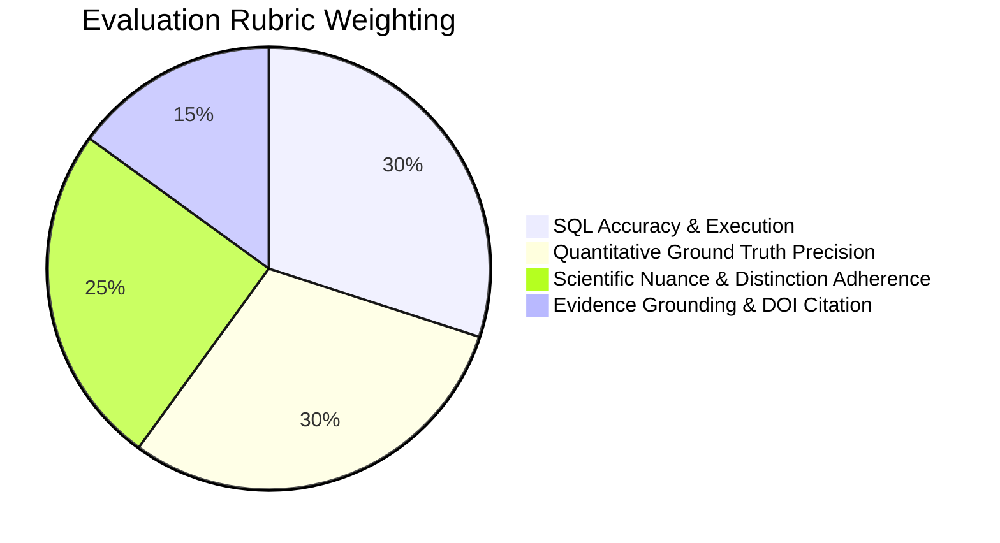

# FOODMECHANICS Evaluation: Expected Results & Benchmark Ground Truth

## 1. Overview and Purpose

This document serves as the golden standard for evaluating the **FOODMECHANICS Intelligence** Databricks Genie Agent. It defines:
1. Exact expected query outcomes and quantitative answers for all evaluation questions (`FM-EVAL-001` through `FM-EVAL-016`).
2. Essential scientific distinctions and physical chemistry principles that the agent must maintain.
3. Strict evaluation rubrics to detect hallucinations, invalid normalizations, and conflation of hypothesis with established scientific consensus.

---

## 2. Core Scientific Distinctions & Guardrails

The Genie Agent must strictly uphold five foundational food science principles. Any agent response violating these principles must be scored as an immediate failure.

### Distinction A: The Volumetric Comparison Fallacy (Mandatory 100g Normalization)
- **The Fallacy**: Comparing nutritional values by casual household units — such as "1 cup of heavy whipping cream" against "1 egg white" or "1 tablespoon of milk".
- **Why It Fails**:
  - 1 cup of heavy cream has a mass of $\sim 238\text{ g}$ to $240\text{ g}$ and contains $\sim 821\text{ kcal}$, $\sim 88\text{ g}$ fat, and $\sim 4.9\text{ g}$ protein.
  - 1 large egg white has a mass of only $\sim 33\text{ g}$ and contains $\sim 17\text{ kcal}$, $\sim 0.06\text{ g}$ fat, and $\sim 3.6\text{ g}$ protein.
  - Comparing unnormalized units creates a false impression of nutrient disparity driven purely by portion size rather than underlying food composition.
- **Golden Baseline**: All comparisons must be standardized to **$100\text{ g}$ of edible material**:
  - **Egg White (per 100g)**: $10.9\text{ g}$ protein, $0.17\text{ g}$ fat, $0.73\text{ g}$ carbs, $52\text{ kcal}$, $87.6\text{ g}$ water. Protein represents **$>90\%$ of total macronutrient calories**.
  - **Heavy Whipping Cream (per 100g)**: $2.1\text{ g}$ protein, $36.1\text{ g}$ fat ($23.0\text{ g}$ saturated), $2.8\text{ g}$ carbs, $345\text{ kcal}$, $57.7\text{ g}$ water. Fat represents **$>94\%$ of total macronutrient calories**.
  - **Whole Cow Milk (per 100g)**: $3.27\text{ g}$ protein, $3.25\text{ g}$ fat, $4.63\text{ g}$ carbs (lactose), $61\text{ kcal}$, $88.1\text{ g}$ water. A balanced colloidal emulsion.

---

### Distinction B: The Dual Nature of Lipids in Foam Physics
- **The Core Paradox**: Why does fat stabilize whipped cream but destroy egg white meringue?
- **Whipped Cream (Fat as Primary Stabilizer via Partial Coalescence)**:
  - Cream is an oil-in-water emulsion of milk fat globules coated with a milk fat globule membrane (MFGM).
  - When whipped at **chilled temperatures ($4^\circ\text{C} - 8^\circ\text{C}$)**, butterfat exists in a semi-crystalline state (partially solid $\beta^\prime$ crystals, partially liquid oil).
  - Mechanical shear causes protruding fat crystal platelets to pierce adjacent globule membranes upon collision.
  - Instead of completely coalescing into bulk oil, globules undergo **partial coalescence**: they fuse into a rigid, interconnected, three-dimensional colloidal skeleton of fat globules that physically traps air cells and stabilizes bubbles against collapse.
- **Egg White Foam (Lipid as Catastrophic Destabilizer via Interfacial Spreading)**:
  - Egg white foam relies on unfolded globular proteins (ovalbumin, ovotransferrin, ovomucin) adsorbing at the air-water interface to form a cohesive, elastic, viscoelastic film.
  - Free non-polar lipids (from egg yolk or residual dairy fat) have significantly lower interfacial tension and higher surface mobility than large folded proteins.
  - Lipids rapidly spread across the air-water boundary, competitively displacing the protein film.
  - Because lipids cannot form cohesive intermolecular hydrogen and disulfide networks, the lamella thins abruptly and the bubble collapses catastrophically.
  - **Empirical threshold**: As little as **$0.1\%$ egg yolk lipid** decreases egg white foam overrun by $>70\%$ and causes premature drainage.

---

### Distinction C: Dynamic Interfacial Elasticity vs. Viscous Drainage Retardation
- **Protein Foaming (Thermodynamic & Mechanical)**:
  - Proteins lower surface tension ($\gamma$) and provide **dilatational surface elasticity** ($E$), meaning the interfacial membrane dynamically resists stretching and thinning during bubble vibrations.
- **Hydrocolloid Stabilization (Rheological / Kinetic)**:
  - Polysaccharides like **xanthan gum**, **guar gum**, or **locust bean gum** are generally non-surface-active: they do not adsorb strongly at the air-water interface or form cohesive elastic surface skins.
  - Instead, they stabilize foams through **continuous-phase rheology**: under Stokes' Law:
    $$v_{\text{drainage}} \propto \frac{g \cdot \Delta\rho}{\eta}$$
    By increasing the aqueous viscosity $\eta$ by several orders of magnitude at low shear, they dramatically retard gravity drainage through Plateau borders.
  - **Key takeaway**: Hydrocolloids provide kinetic drainage stability ($t_{1/2} > 180\text{ min}$), but cannot generate high overrun independently without a surfactant/protein.

---

### Distinction D: Room-Temperature Foam Stability vs. Thermal Baking Coagulation
- **The Substitution Trap**: A user asks: *"Can I replace egg whites in an angel food cake with milk + xanthan gum?"*
- **What Works**:
  - In an unbaked, chilled dessert mousse, milk proteins + xanthan gum can provide adequate volume and excellent drainage resistance.
- **Why It Fails in Baking**:
  - Egg white proteins possess specific thermal denaturation thresholds: ovotransferrin unfolds at $61^\circ\text{C}-65^\circ\text{C}$ and ovalbumin crosslinks at $84.5^\circ\text{C}$, exposing free sulfhydryl ($-SH$) groups that form covalent intermolecular disulfide ($-S-S-$) bonds. This solidifies the wet foam into a rigid, heat-set porous sponge that holds its shape when cool.
  - Casein in milk is a non-globular, intrinsically disordered phosphoprotein that is remarkably heat-stable up to $140^\circ\text{C}$ and does not heat-coagulate at baking temperatures.
  - Xanthan gum is a physical thickening polymer whose viscosity actually thins reversibly upon heating.
  - **Culinary outcome**: When heated in the oven, the air bubbles expand; without a heat-setting protein matrix, the milk + xanthan foam collapses into a gummy, flat layer upon cooling.

---

### Distinction E: Scientific Consensus vs. Experimental Hypotheses
- **Data Rules 5, 7, and 8**:
  - A mechanism supported by peer-reviewed literature with direct DOI citations is an **established scientific finding** (`PEER_REVIEWED` / `ESTABLISHED_CONSENSUS`).
  - An untested ingredient substitution (e.g. replacing egg white with aquafaba or milk + hydrocolloid in a specific cake) is an **empirical formulation hypothesis** (`HYPOTHESIS` / `is_hypothesized = TRUE`).
  - The agent must never claim that because two ingredients share similar viscosity profiles, they are guaranteed to perform identically in culinary practice without experimental validation.

---

## 3. Benchmark Questions & Detailed Ground Truth

| Question ID | Question Summary | Category | Difficulty | Golden Expected Values & Key Factual Points |
|---|---|---|---|---|
| **FM-EVAL-001** | Standardized 100g nutritional comparison (Egg White vs Whole Milk vs Heavy Cream) | Nutritional Normalization | Easy | **Egg White**: $10.9\text{g}$ protein, $0.17\text{g}$ fat, $52\text{kcal}$. **Heavy Cream**: $2.1\text{g}$ protein, $36.1\text{g}$ fat ($23.0\text{g}$ sat fat), $345\text{kcal}$. **Whole Milk**: $3.3\text{g}$ protein, $3.3\text{g}$ fat, $61\text{kcal}$. Protein accounts for $>90\%$ of egg white calories, while fat accounts for $>94\%$ of cream calories. |
| **FM-EVAL-002** | Molecular drivers of egg white foaming capacity | Foam Physics & Mechanisms | Medium | Key proteins: **Ovalbumin** ($45\text{ kDa}$, $54\%$ of protein, $T_m = 84.5^\circ\text{C}$), **Ovotransferrin** ($76\text{ kDa}$, $12\%$, $T_m = 61.0^\circ\text{C}$, fast adsorption), **Ovomucin** ($220-400\text{ kDa}$, fibrous, increases lamellar viscosity). Measured overrun: $850\%$. |
| **FM-EVAL-003** | Fat-stabilized (cream) vs protein-stabilized (meringue) foam mechanisms | Foam Physics & Mechanisms | Hard | **Meringue**: Interfacial globular protein denaturation and cohesive viscoelastic film formation; room temp whipping, baked to set. **Cream**: Partial coalescence of solid fat globules forming a 3D skeleton around bubbles; strictly requires chilling ($4-8^\circ\text{C}$). |
| **FM-EVAL-004** | Why free lipids collapse egg white foam but stabilize cream | Foam Physics & Mechanisms | Hard | Free lipids have lower interfacial tension and spread across the air-water interface, displacing the elastic protein film without providing mechanical strength. Cream confines fat within intact globule membranes that partially coalesce at low temperatures. |
| **FM-EVAL-005** | Mechanisms and stabilizers preventing foam drainage | Rheology & Stabilizers | Medium | Mechanism: `MECH_DRAINAGE_RETARDATION_VISCOSITY` (Stokes' law). Top stabilizer: **Xanthan gum** ($0.5\%$ conc.) achieves drainage half-life $t_{1/2} \ge 180\text{ min}$, vs unassisted egg white baseline $t_{1/2} \approx 45-60\text{ min}$. |
| **FM-EVAL-006** | Nutritional and structural trade-off: Egg white vs milk + xanthan gum | Ingredient Substitution | Complex | **Nutritional shift**: Protein drops from $10.9\text{g}$ to $3.4\text{g}$ per $100\text{g}$ ($68\%$ reduction); carbs increase from $0.7\text{g}$ to $4.7\text{g}$ (lactose). **Structural shift**: Lower overrun ($250-400\%$ vs $850\%$); high room-temp drainage stability ($t_{1/2} > 150\text{ min}$); total loss of thermal baking coagulability. |
| **FM-EVAL-007** | Protein screening for high overrun ($>400\%$) | Functional Screening | Medium | Top hit: **Egg White (Albumen)** at $850\%$ overrun, driven by ovotransferrin, ovalbumin, and lysozyme. |
| **FM-EVAL-008** | Trace interfacial protein denaturation to literature and DOIs | Scientific Provenance | Medium | Cites peer-reviewed papers (e.g. Foegeding et al., Dickinson, Belitz) with valid DOI (e.g. `10.1016/j.foodhyd.2005.10.012`) in *Food Hydrocolloids* or *Food Chemistry*. |
| **FM-EVAL-009** | Peer-reviewed evidence for partial fat coalescence in dairy foams | Scientific Provenance | Medium | Cites Walstra, Goff, or Fredrick detailing fat crystal piercing and network formation at $4-8^\circ\text{C}$ with DOI `10.1016/j.idairyj.2006.06.013`. |
| **FM-EVAL-010** | Thermal denaturation thresholds of egg white proteins | Food Chemistry & Thermodynamics | Medium | **Ovotransferrin**: $61.0^\circ\text{C}-65.0^\circ\text{C}$ (early thermal setting); **Ovalbumin**: $84.0^\circ\text{C}-84.5^\circ\text{C}$ (final structural crumb setting); Exposure of hydrophobic residues and $-SH$ groups drives covalent disulfide crosslinking. |
| **FM-EVAL-011** | Recipe-level macronutrient comparison: Meringue vs Whipped Cream | Recipe Formulation | Hard | **Meringue (per 100g)**: $\sim 215\text{ kcal}$, $\sim 4.5\text{g}$ protein, $\sim 0.1\text{g}$ fat, $\sim 52\text{g}$ carbs (sucrose). **Whipped Cream (per 100g)**: $\sim 330\text{ kcal}$, $\sim 2.0\text{g}$ protein, $\sim 33.5\text{g}$ fat, $\sim 8.5\text{g}$ carbs. Meringue is high-carb / zero-fat; whipped cream is high-fat / low-carb. |
| **FM-EVAL-012** | Identifying food science mechanisms with limited evidence / hypotheses | Evidence Gaps | Hard | Flags mechanisms with zero or single peer-reviewed citations, or flagged with `is_hypothesized = TRUE` (e.g. complex plant-protein / hydrocolloid hybrid synergisms). |
| **FM-EVAL-013** | Impact of temperature on cream whipping in experiments | Processing & Physics | Medium | **At 4-8°C**: Overrun $\sim 110\%$, $t_{1/2} > 240\text{ min}$, mean bubble size $\sim 20\mu\text{m}$, successful partial coalescence. **At >20°C**: Trial fails; complete coalescence/churn into butter or liquid oil; rapid collapse. |
| **FM-EVAL-014** | Impact of sucrose addition timing on meringue overrun and stability | Food Chemistry & Processing | Hard | Early sugar delays protein denaturation and lowers overrun by increasing liquid viscosity and stabilizing native folds; late sugar dissolves into mature lamellae, retarding drainage and evaporation without impeding initial overrun. |
| **FM-EVAL-015** | Overrun and stability across egg white whip times | Processing & Physics | Medium | Short whip ($<2\text{ min}$): under-aerated, large bubbles, low stability. Optimal ($4-6\text{ min}$): maximum overrun ($850\%$), uniform microbubbles ($22\mu\text{m}$), high elasticity. Overwhipping ($>10\text{ min}$): protein clumping, syneresis, dry grainy texture. |
| **FM-EVAL-016** | Query Gold analytical view `v_mechanism_evidence` | Scientific Provenance | Easy | Returns denormalized mechanism-to-literature records with mechanism name, class, active compound, publication title, authors, and DOI. |

---

## 4. Evaluation Scoring Rubric

Each test question is evaluated on a 10-point scale across four dimensions:

1. **SQL Accuracy & Execution (30%)**:
   - Query parses and executes cleanly against `workspace.foodmechanics_gold` / `workspace.foodmechanics_silver` (or local DuckDB).
   - Correct join paths, table aliases, and filter predicates (`is_100g_normalized = TRUE`).
2. **Quantitative Precision (30%)**:
   - Numerical values match golden standards within $\pm 5\%$ tolerance.
3. **Scientific Nuance & Distinction Adherence (25%)**:
   - Correctly articulates why fat behaves differently in cream vs egg whites.
   - Preserves distinction between foaming capacity (overrun) and drainage stability ($t_{1/2}$).
   - Clearly flags baking limitations in hydrocolloid substitutions.
4. **Evidence Grounding (15%)**:
   - Correctly attributes mechanisms to peer-reviewed literature with valid author, journal, and DOI metadata.
