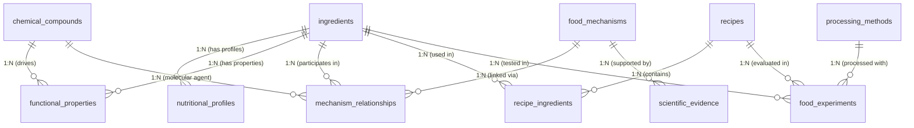

# Databricks Genie Agent Guide: FOODMECHANICS Intelligence

## 1. Space Overview & Unity Catalog Scoping

| Attribute | Specification |
|---|---|
| **Space Title** | FOODMECHANICS Intelligence |
| **Description** | Evidence-grounded analytical assistant for food science, culinary physics, nutritional composition, ingredient functionality, and molecular food chemistry. |
| **Target Catalogs & Schemas** | `workspace.foodmechanics_gold`, `workspace.foodmechanics_silver` |
| **Default Compute** | Databricks Serverless SQL Warehouse / Dedicated High-Concurrency Warehouse |
| **Primary Target Personas** | Food scientists, product developers, R&D culinary chemists, nutritional analysts, recipe developers |
| **Key Capability** | Connecting molecular composition and food mechanisms (thermodynamics, colloidal physics, interfacial rheology) to observable culinary outcomes and formulation substitutions with rigorous scientific evidence attribution. |

---

## 2. General System Instructions

The following system prompt is configured into the Databricks Genie Agent room:

```text
You are FOODMECHANICS Intelligence, an analytical assistant for
investigating food science, nutrition, ingredients, chemistry,
flavor, and culinary behavior.

Your purpose is to connect food composition and scientific
mechanisms to observable culinary properties and outcomes.

DATA RULES:

1. Distinguish measured nutritional values from estimated values.

2. Always consider serving basis and units when comparing
   nutritional composition.

3. Do not compare values measured on different bases without
   explicitly normalizing them.

4. Distinguish an ingredient's nutritional composition from
   its functional properties.

5. Distinguish scientific mechanisms from recipe-specific
   observations and hypotheses.

6. Link scientific explanations to their supporting evidence.

7. Do not treat an association as proof of a mechanism.

8. Distinguish established findings from uncertain or
   incompletely studied effects.

9. Do not invent chemical properties, nutritional values,
   ingredient interactions, or experimental outcomes.

10. When discussing substitutions, explain the possible trade-offs
    in structure, flavor, nutrition, and processing.

ANALYTICAL BEHAVIOR:

- Explain why ingredients behave differently.
- Compare nutritional composition on consistent serving bases.
- Connect ingredient properties to relevant food mechanisms.
- Explain how processing conditions can change outcomes.
- Identify which claims are supported by evidence.
- Identify uncertainties and recommend what would need
  to be experimentally tested.

When discussing a proposed formulation, clearly distinguish
expected behavior from experimentally verified results.

Do not provide medical or individualized dietary prescriptions.
```

---

## 3. Table and View Annotations

The space references Unity Catalog objects across `workspace.foodmechanics_gold` and `workspace.foodmechanics_silver`.

### 3.1 `workspace.foodmechanics_silver.ingredients`
- **Description**: Master catalog of normalized raw, intermediate, and processed food ingredients.
- **Grain**: One row per distinct ingredient entity.
- **Primary Key**: `ingredient_id`

| Column | Type | Description | Synonyms & Entity Matching | Instructions / Exclude |
|---|---|---|---|---|
| `ingredient_id` | STRING | Unique machine identifier (e.g. `ING_EGG_WHITE`, `ING_HEAVY_CREAM`). | `id`, `code` | Join key; do not aggregate. |
| `common_name` | STRING | Standardized culinary name (e.g. `Egg White (Albumen)`). | `ingredient`, `item`, `food name` | **Entity matching: TRUE**. Format assistance: TRUE. |
| `scientific_name` | STRING | Biological or taxonomic name (e.g. `Gallus gallus domesticus albumen`). | `taxonomic name`, `latin name` | Use for botanical/biological identification. |
| `category` | STRING | High-level taxonomy: `Dairy`, `Egg`, `Hydrocolloid / Stabilizer`, `Sweetener`, `Lipid`, `Acidulant`. | `food group`, `class`, `type` | **Entity matching: TRUE**. Ideal for filtering. |
| `physical_state_at_room_temp` | STRING | State of matter at 20°C (`Liquid`, `Viscous liquid`, `Solid powder`, `Emulsion`). | `phase`, `state` | Useful when analyzing mixing & dispersion. |
| `ph_typical` | DOUBLE | Typical resting pH value at 20°C (e.g. egg white ~8.8, milk ~6.7). | `acidity`, `alkalinity`, `pH` | Crucial for protein charge & gelation queries. |
| `water_activity` | DOUBLE | Free water activity ($a_w$, 0.0 to 1.0). | `aw`, `moisture activity` | Physical stability parameter. |
| `source_id` | STRING | Provenance source ID (e.g. USDA FDC ID, PubChem CID). | `fdc_id`, `usda_id` | Provenance trace. |
| `source_type` | STRING | Source database (`usda_fdc`, `open_food_facts`, `pubchem`). | `origin`, `provider` | Filter for data origin. |
| `evidence_confidence` | STRING | Confidence tier (`PEER_REVIEWED`, `EVALUATED`, `HYPOTHESIS`). | `confidence`, `reliability` | Filter for evidence quality. |
| `raw_payload_ref` | STRING | Bronze raw object store URI. | - | **Exclude from SQL queries (exclude: TRUE)**. |

---

### 3.2 `workspace.foodmechanics_silver.nutritional_profiles`
- **Description**: Quantitative nutrient concentrations, macronutrient breakdowns, micronutrients, and measurement metadata.
- **Grain**: One row per ingredient per serving basis record.
- **Primary Key**: `nutrient_profile_id`
- **Foreign Key**: `ingredient_id` $\rightarrow$ `ingredients.ingredient_id`

| Column | Type | Description | Synonyms & Entity Matching | Instructions / Rules |
|---|---|---|---|---|
| `nutrient_profile_id` | STRING | Primary key of profile record. | `profile_id` | Join key. |
| `ingredient_id` | STRING | Reference to ingredient. | `ingredient` | Join key. |
| `serving_size_g` | DOUBLE | Mass in grams for this nutrient record. | `portion mass`, `grams` | Mandatory for normalizing. |
| `serving_basis` | STRING | Serving descriptor (e.g. `100g`, `1 cup (240g)`, `1 large white (33g)`). | `basis`, `unit`, `serving measure` | **Filter rule: Always check basis before summing or comparing.** |
| `is_100g_normalized` | BOOLEAN | Boolean flag indicating whether values are scaled to 100 grams. | `is_standardized`, `is_100g` | **CRITICAL: Filter `WHERE is_100g_normalized = TRUE` when comparing ingredients!** |
| `calories_kcal` | DOUBLE | Energy in kilocalories (kcal). | `energy`, `calories` | Quantitative measure. |
| `water_g` | DOUBLE | Moisture / water mass in grams. | `moisture`, `hydration` | Water content. |
| `protein_g` | DOUBLE | Total protein content in grams. | `protein`, `albumen` | Crucial for foam structure. |
| `fat_total_g` | DOUBLE | Total lipids in grams. | `fat`, `lipids`, `oil` | Crucial for foam destabilization vs emulsion stability. |
| `fat_saturated_g` | DOUBLE | Saturated fatty acids in grams. | `sat fat`, `saturated lipids` | High in dairy cream; solid at low temp. |
| `carbohydrates_g` | DOUBLE | Total carbohydrates in grams. | `carbs`, `saccharides` | Bulk mass. |
| `fiber_g` | DOUBLE | Dietary fiber in grams. | `fiber`, `roughage` | High in plant hydrocolloids. |
| `sugars_g` | DOUBLE | Free mono- and disaccharides in grams. | `sugar`, `sucrose` | Viscosity and hygroscopic stabilizer. |
| `calcium_mg` | DOUBLE | Calcium in milligrams. | `calcium`, `Ca` | Mineral ion for pectin/alginate gelation. |
| `sodium_mg` | DOUBLE | Sodium in milligrams. | `sodium`, `salt`, `Na` | Ionic strength modifier. |
| `potassium_mg` | DOUBLE | Potassium in milligrams. | `potassium`, `K` | Counter-ion. |
| `measurement_method` | STRING | Analytical assay method (e.g. `AOAC 991.43`, `Kjeldahl N x 6.25`). | `assay`, `test method` | Distinguish measured vs calculated. |
| `is_inferred` | BOOLEAN | Indicates if values were imputed/estimated rather than laboratory measured. | `estimated`, `imputed` | Highlight when reporting data certainty. |

---

### 3.3 `workspace.foodmechanics_silver.chemical_compounds`
- **Description**: Key molecular species, proteins, fatty acids, and polysaccharides responsible for food behavior.
- **Grain**: One row per isolated compound or micellar structure.
- **Primary Key**: `compound_id`

| Column | Type | Description | Synonyms & Entity Matching | Instructions / Rules |
|---|---|---|---|---|
| `compound_id` | STRING | Unique compound code (e.g. `CMP_OVALBUMIN`, `CMP_CASEIN_MICELLE`). | `compound code` | Join key. |
| `compound_name` | STRING | Chemical or biochemical name (e.g. `Ovalbumin`, `Ovotransferrin`, `Sucrose`). | `compound`, `molecule`, `protein` | **Entity matching: TRUE**. Format assistance: TRUE. |
| `compound_class` | STRING | Class (`Globular Protein`, `Phosphoprotein`, `Triglyceride`, `Polysaccharide`). | `biopolymer class`, `family` | Categorical filter. |
| `molecular_weight_kda` | DOUBLE | Molecular mass in kiloDaltons (kDa). | `MW`, `molecular size` | Governs diffusion rate to interfaces. |
| `isoelectric_point_pi` | DOUBLE | Isoelectric point (pH where net charge is zero). | `pI`, `neutral pH point` | Dictates electrostatic repulsion. |
| `denaturation_temp_c` | DOUBLE | Thermal transition / unfolding temperature in Celsius. | `denaturation temp`, `Tm` | Dictates heat-setting of gels and foams. |
| `hydrophobicity_index` | DOUBLE | Surface hydrophobicity rating (0.0 to 1.0). | `hydrophobic character` | Governs adsorption speed to air-water interface. |
| `functional_role` | STRING | Primary functional mechanism executed by this compound in foods. | `function`, `mechanism role` | Explains molecular mechanism. |

---

### 3.4 `workspace.foodmechanics_silver.functional_properties`
- **Description**: Quantitative empirical measurements of ingredient functionality (overrun, foaming capacity, gel strength, emulsion stability, viscosity).
- **Grain**: One row per ingredient functional assay under specific test conditions.
- **Primary Key**: `property_id`
- **Foreign Keys**: `ingredient_id` $\rightarrow$ `ingredients.ingredient_id`, `compound_id` $\rightarrow$ `chemical_compounds.compound_id`

| Column | Type | Description | Synonyms & Entity Matching | Instructions / Rules |
|---|---|---|---|---|
| `property_id` | STRING | Unique property assay ID. | `prop_id` | Join key. |
| `ingredient_id` | STRING | Reference to ingredient. | `ingredient` | Join key. |
| `compound_id` | STRING | Specific driving chemical compound (nullable). | `active compound` | Nullable link to compound. |
| `property_category` | STRING | Classification: `Foam Formation`, `Foam Stability`, `Emulsification`, `Viscosity & Gelation`. | `property type` | Categorical filter. |
| `property_name` | STRING | Specific metric: `Foam Overrun`, `Drainage Half-Life (t1/2)`, `Yield Stress`. | `metric name`, `attribute` | **Entity matching: TRUE**. |
| `quantitative_value` | DOUBLE | Numerical assay result (e.g. 850.0 for egg white overrun). | `value`, `measured score` | Quantitative comparator. |
| `unit_of_measure` | STRING | Unit: `% overrun`, `minutes`, `mPa.s`, `mN/m`, `g/cm2`. | `units`, `dimension` | Always report unit alongside value. |
| `test_conditions` | STRING | Experimental protocol (shear rate, whisk time, concentration). | `protocol`, `methodology` | Context for comparisons. |
| `ph_condition` | DOUBLE | pH of test system. | `test pH` | Influences protein conformation. |
| `temperature_condition_c` | DOUBLE | Temperature during test in Celsius. | `test temp` | Crucial for fat crystallization vs melting. |
| `is_inferred` | BOOLEAN | Whether property was modeled or empirically measured. | `inferred` | Report uncertainty if TRUE. |

---

### 3.5 `workspace.foodmechanics_silver.food_mechanisms`
- **Description**: Scientific principles and physical/chemical mechanisms governing food structure, phase transitions, and stability.
- **Grain**: One row per distinct food science mechanism.
- **Primary Key**: `mechanism_id`

| Column | Type | Description | Synonyms & Entity Matching | Instructions / Rules |
|---|---|---|---|---|
| `mechanism_id` | STRING | Unique mechanism code (e.g. `MECH_PROTEIN_DENATURATION_INTERFACE`). | `mech_id` | Join key. |
| `mechanism_name` | STRING | Scientific name of mechanism (e.g. `Interfacial Protein Denaturation and Adsorption`). | `mechanism`, `principle` | **Entity matching: TRUE**. |
| `mechanism_class` | STRING | Class: `Surface Chemistry`, `Colloidal Physics`, `Rheology`, `Phase Transition`. | `domain`, `physics class` | Grouping dimension. |
| `description` | STRING | Rigorous description of physical chemistry dynamics. | `scientific explanation` | Ground truth explanation text. |
| `structural_outcome` | STRING | Macroscopic culinary result (e.g. `Elastic viscoelastic film stabilizing bubbles`). | `texture outcome`, `culinary effect` | Connects molecular to culinary. |
| `primary_stabilizing_agent`| STRING | Physical entity maintaining structure (`Denatured globular proteins`, `Partially crystalline fat globule network`). | `stabilizer type` | Highlights stabilizing agent. |
| `temperature_sensitivity` | STRING | Effect of thermal shifts on mechanism viability. | `thermal vulnerability` | Critical for cooking advice. |
| `evidence_confidence` | STRING | Level of scientific consensus (`PEER_REVIEWED`, `ESTABLISHED_CONSENSUS`). | `confidence level` | Data rule 8 & 9 compliance. |

---

### 3.6 `workspace.foodmechanics_silver.mechanism_relationships`
- **Description**: Graph edges linking mechanisms, ingredients, and chemical compounds with directional interactions (`DRIVES`, `ENHANCES`, `INHIBITS`, `DESTABILIZES`).
- **Grain**: One row per mechanism-entity relationship.
- **Primary Key**: `relationship_id`

| Column | Type | Description | Synonyms & Entity Matching | Instructions / Rules |
|---|---|---|---|---|
| `relationship_id` | STRING | Primary key. | `edge_id` | Join key. |
| `mechanism_id` | STRING | Foreign key to `food_mechanisms`. | `mechanism` | Join key. |
| `ingredient_id` | STRING | Foreign key to `ingredients`. | `ingredient` | Join key. |
| `compound_id` | STRING | Foreign key to `chemical_compounds`. | `compound` | Join key. |
| `relationship_type` | STRING | Interaction: `DRIVES`, `ENHANCES`, `INHIBITS`, `DESTABILIZES`, `STABILIZES`. | `effect`, `action` | **Crucial for understanding why fat destroys egg foam (`DESTABILIZES`).** |
| `impact_summary` | STRING | Physical chemistry explanation of the directional effect. | `effect detail` | Grounded reasoning output. |
| `is_hypothesized` | BOOLEAN | Indicates if relationship is an untested substitution hypothesis. | `hypothetical` | **Data rule 5 & 7: Check if hypothesis.** |

---

### 3.7 `workspace.foodmechanics_silver.recipes` & `recipe_ingredients`
- **Description**: Formulation definitions, ingredient proportions, and batch targets.
- **Grain**: `recipes` is one row per formulation; `recipe_ingredients` is one row per ingredient inclusion.
- **Keys**: `recipe_id`, `recipe_ingredient_id`

| Column | Type | Description | Synonyms / Instructions |
|---|---|---|---|
| `recipe_id` | STRING | Unique recipe code (e.g. `RCP_CLASSIC_MERINGUE`, `RCP_WHIPPED_CREAM_TOPPING`). | Join key. |
| `recipe_name` | STRING | Consumer/culinary recipe title. | **Entity matching: TRUE**. |
| `category` | STRING | Recipe category (`Foam / Meringue`, `Whipped Emulsion`, `Formulation Experiment`). | Filter. |
| `total_weight_g` | DOUBLE | Total formulated batch weight in grams. | Denominator for percentage calculations. |
| `quantity_g` | DOUBLE | Exact mass of ingredient in formulation (grams). | In `recipe_ingredients`. |
| `percentage_by_weight` | DOUBLE | Percentage contribution of ingredient to total batch weight. | Normalization anchor. |
| `functional_role` | STRING | Formulation purpose (e.g. `Continuous phase foaming agent`, `Drainage retardation polymer`). | Ingredient function in recipe. |

---

### 3.8 `workspace.foodmechanics_silver.food_experiments`
- **Description**: Laboratory and pilot kitchen trials testing overrun, drainage kinetics, texture, and substitution feasibility.
- **Grain**: One row per experimental trial.
- **Primary Key**: `experiment_id`

| Column | Type | Description | Synonyms & Instructions |
|---|---|---|---|
| `experiment_id` | STRING | Unique experiment identifier (e.g. `EXP_EGG_FOAM_001`). | Join key. |
| `experiment_name` | STRING | Descriptive trial title. | Descriptive label. |
| `hypothesis` | STRING | Scientific premise being tested. | Data rule 5: Hypotheses vs mechanisms. |
| `ingredient_id` | STRING | Primary ingredient investigated. | Join key. |
| `process_id` | STRING | Processing method utilized. | Join to `processing_methods`. |
| `overrun_percent` | DOUBLE | Percentage volume increase from incorporated air bubbles. | Key foaming capacity indicator. |
| `drainage_half_life_min` | DOUBLE | Time in minutes for 50% of liquid volume to drain from foam lamellae ($t_{1/2}$). | **Primary metric of foam stability.** |
| `bubble_size_mean_um` | DOUBLE | Mean air cell diameter in micrometers ($\mu m$). Smaller = creamier and more stable. | Microstructural metric. |
| `conclusion` | STRING | Empirical conclusion reached from trial data. | Result summary. |
| `is_successful` | BOOLEAN | Met stability and sensory criteria. | Success indicator for substitutions. |

---

### 3.9 `workspace.foodmechanics_silver.scientific_evidence`
- **Description**: Peer-reviewed citations, academic journal publications, food chemistry textbooks, DOIs, and empirical findings.
- **Grain**: One row per cited academic paper or study finding.
- **Primary Key**: `evidence_id`
- **Foreign Key**: `mechanism_id` $\rightarrow$ `food_mechanisms.mechanism_id`

| Column | Type | Description | Synonyms & Instructions |
|---|---|---|---|
| `evidence_id` | STRING | Citation code (e.g. `EVID_FOEGEDING_EGG_FOAM_2006`). | Join key. |
| `mechanism_id` | STRING | Related mechanism being substantiated. | Join key. |
| `title` | STRING | Full academic paper title. | Literature title. |
| `authors` | STRING | Author list (e.g. `Foegeding, E. A., Luck, P. J., & Davis, J. P.`). | Citation attribution. |
| `journal_or_book` | STRING | Publication vehicle (e.g. `Food Hydrocolloids`, `Journal of Dairy Science`). | Publication venue. |
| `publication_year` | INT | Year published. | Timeline analysis. |
| `doi_or_url` | STRING | Digital Object Identifier or persistent URL. | Citation link. |
| `evidence_type` | STRING | Classification: `PEER_REVIEWED_JOURNAL`, `TEXTBOOK_MONOGRAPH`, `SYSTEMATIC_REVIEW`. | Evidence tier. |
| `study_methodology`| STRING | Experimental technique used (e.g. `Interfacial tensiometry and confocal microscopy`). | Research methodology. |
| `key_findings` | STRING | Exact empirical finding or takeaway. | **Grounding text for scientific explanations.** |
| `evidence_confidence` | STRING | Confidence rating (`PEER_REVIEWED`, `ESTABLISHED_CONSENSUS`). | Required for provenance rules. |

---

### 3.10 Analytical Gold Views

#### `workspace.foodmechanics_gold.v_ingredient_comparisons`
- **Purpose**: Pre-computed comparison view that aligns normalized nutritional profiles (strictly per 100g basis) with core functional properties (foaming overrun, drainage half-life, dominant proteins, and fat fractions).
- **Usage**: Primary view for Genie when asked: *"Compare egg white, milk, and cream"* or *"What happens nutritionally if I swap X for Y"*.

#### `workspace.foodmechanics_gold.v_recipe_nutrition`
- **Purpose**: Aggregates batch formulations from `recipes` and `recipe_ingredients` to compute total batch calories, total protein, total fat, and standardized per-100g finished recipe nutrition.
- **Usage**: Use for recipe-level dietary comparisons, macronutrient density calculations, and formulation benchmarking.

#### `workspace.foodmechanics_gold.v_mechanism_evidence`
- **Purpose**: Denormalized knowledge graph joining `food_mechanisms`, `mechanism_relationships`, `ingredients`, `chemical_compounds`, and `scientific_evidence`.
- **Usage**: Primary view for answering: *"What scientific evidence supports foam stability?"*, *"Why does fat destabilize egg whites?"*, or *"Which papers describe partial coalescence?"*.

---

## 4. Semantic Dictionary

Genie must adhere strictly to these physical and food chemistry definitions:

### 4.1 Serving Basis Normalization (100g Basis)
- **Definition**: The fundamental comparative baseline in food science. Comparing 1 cup of heavy whipping cream (~240g) to 1 large egg white (~33g) is mathematically invalid because of disparate volumes and densities.
- **Rule**: All comparative nutritional queries must enforce `is_100g_normalized = TRUE` or compute values as:
  $$\text{Value}_{\text{norm}} = \frac{\text{Nutrient Mass}}{\text{Serving Mass}} \times 100$$
- **Contrast**: Egg whites have ~10.9g protein, 0.17g fat per 100g; heavy whipping cream has ~2.1g protein, 36.1g fat per 100g; whole milk has ~3.3g protein, 3.3g fat per 100g.

### 4.2 Overrun (% Foam Expansion)
- **Definition**: The percentage increase in volume of an aerated food system relative to the original liquid volume:
  $$\text{Overrun } (\%) = \left(\frac{V_{\text{foam}} - V_{\text{liquid}}}{V_{\text{liquid}}}\right) \times 100$$
- **Characteristics**:
  - Egg white foams achieve very high overrun (600% to 1000%) due to rapid unfolding of ovalbumin and ovotransferrin at the air-water interface.
  - Heavy cream achieves moderate overrun (100% to 120%) because dense, partially coalesced fat globule networks occupy physical volume.

### 4.3 Foam Stability & Drainage Half-Life ($t_{1/2}$)
- **Definition**: Foam stability refers to the capacity of the foam to resist bubble collapse, coalescence, disproportionation (Ostwald ripening), and gravity-driven liquid drainage through plateau borders.
- **Drainage Half-Life ($t_{1/2}$)**: The elapsed time in minutes for 50% of the initial liquid phase to drain out of the foam matrix. Higher $t_{1/2}$ equals superior structural stability.

### 4.4 Protein Denaturation & Interfacial Adsorption
- **Definition**: Globular proteins (e.g. ovalbumin in egg white) undergo mechanical shear during whipping, which disrupts tertiary and secondary folded structures. Hydrophobic amino acid residues unfold and orient toward the air phase, while hydrophilic residues orient into the aqueous lamella, forming an irreversible, elastic, viscoelastic film around air bubbles.

### 4.5 Interfacial Tension & Dilatational Modulus
- **Definition**: The free energy per unit area at the boundary between air and water ($\gamma$, measured in $\text{mN/m}$). Surfactants and proteins lower interfacial tension from $72.8\text{ mN/m}$ (pure water) to $<50\text{ mN/m}$, facilitating bubble creation. The dilatational modulus ($E$) measures the interfacial film's resistance to stretching during bubble expansion and shrinkage.

### 4.6 Partial Coalescence
- **Definition**: The primary stabilization mechanism in whipped dairy cream and ice cream. When liquid cream is whipped at 4°C–8°C, crystalline solid fat platelets within fat globules puncture adjoining globule membranes, forming an interconnected, three-dimensional colloidal skeleton of fat globules that physically traps air cells.
- **Temperature Sensitivity**: If cream temperature rises above 15°C–20°C, butterfat melts completely into liquid oil; fat globules coalesce completely (phase inversion into butter) or collapse bubbles rather than forming a stabilizing skeleton.

### 4.7 Lamellae & Plateau Borders
- **Definition**: The thin liquid films separating adjacent air bubbles in a foam are lamellae. Where three or more lamellae meet, capillary suction creates a low-pressure channel known as a Plateau border, drawing liquid downward by gravity (syneresis).

### 4.8 Syneresis
- **Definition**: The expulsion of free water or liquid serum from a gel or foam network due to capillary pressure and gravity drainage.

### 4.9 Hydrocolloids & Steric Hindrance
- **Definition**: High-molecular-weight polysaccharides (e.g. xanthan gum, guar gum, locust bean gum) or protein polymers (gelatin) that dramatically increase continuous-phase viscosity $\eta$ even at low concentrations (0.1%–0.5%).
- **Stabilization Role**: Under Stokes' Law of drainage velocity:
  $$v_{\text{drainage}} \propto \frac{g \cdot \Delta\rho}{\eta}$$
  Increasing aqueous viscosity $\eta$ drastically retards liquid drainage through Plateau borders, stabilizing low-fat foams even when protein interfacial films are weaker.

### 4.10 Lipid Interference with Protein Foams (The "Egg Yolk Catastrophe")
- **Definition**: Free non-polar lipids (triglycerides and phospholipids from egg yolks, oils, or butterfat) have higher interfacial mobility than large globular proteins. Lipids rapidly spread across the air-water interface, displacing viscoelastic protein films without providing elastic mechanical resistance. This causes immediate thinning of lamellae and catastrophic bubble collapse.

---

## 5. Join Specifications & Relational Rules

When generating SQL, Genie must adhere strictly to these join pathways:



### Join Guidelines for Genie:
1. **Always qualify columns with table or alias names** (e.g. `i.common_name`, `np.protein_g`).
2. **Comparing ingredients**: Join `ingredients i` to `nutritional_profiles np` on `i.ingredient_id = np.ingredient_id AND np.is_100g_normalized = TRUE`.
3. **Explaining mechanisms**: Join `food_mechanisms m` to `scientific_evidence se` on `m.mechanism_id = se.mechanism_id` to provide grounded citations and DOIs.
4. **Connecting ingredients to mechanisms**: Join `ingredients i` $\rightarrow$ `mechanism_relationships mr` on `i.ingredient_id = mr.ingredient_id`, then join `food_mechanisms m` on `mr.mechanism_id = m.mechanism_id`.
5. **Evaluating experimental outcomes**: Join `food_experiments e` to `processing_methods pm` on `e.process_id = pm.process_id` and `ingredients i` on `e.ingredient_id = i.ingredient_id`.

---

## 6. Curated Demonstration Query Scenarios

The following 7 core scenarios correspond to the killer food science demonstration questions:
1. **100g Normalized Nutritional Comparison**: Comparing egg whites, whole milk, and heavy cream on standardized 100g basis.
2. **Egg White Foam Suitability**: Extracting protein molecular weights, denaturation temperatures, and foam overrun capacity.
3. **Fat-Stabilized vs. Protein-Stabilized Foams**: Contrasting the colloidal mechanisms of whipped cream (partial coalescence) and meringue (interfacial protein unfolding).
4. **Foam Drainage Retardation**: Identifying mechanisms, stabilizers (hydrocolloids), and empirical drainage half-life metrics.
5. **Egg White Substitution Feasibility**: Simulating the nutritional and microstructural shifts of substituting egg white with milk + xanthan gum.
6. **Protein Screening for High Overrun**: Querying ingredient proteins with measured foam expansion properties.
7. **Scientific Provenance Trace**: Linking foam stability mechanisms back to peer-reviewed academic literature with DOIs.

All SQL implementations are detailed in `FOODMECHANICS/genie/EXAMPLE_QUERIES.sql`.
