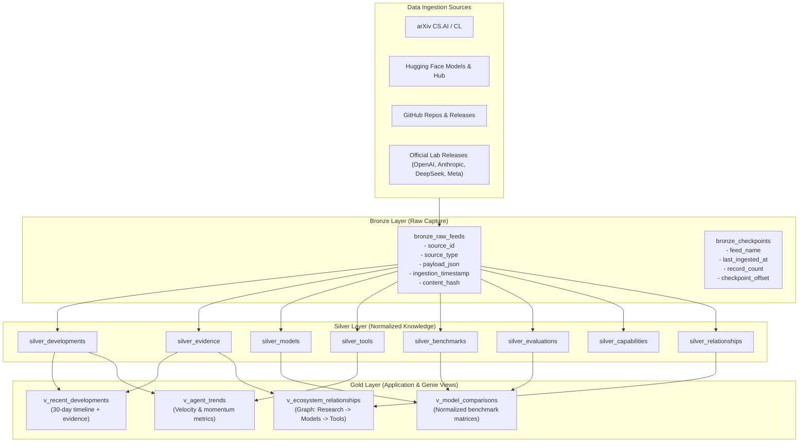
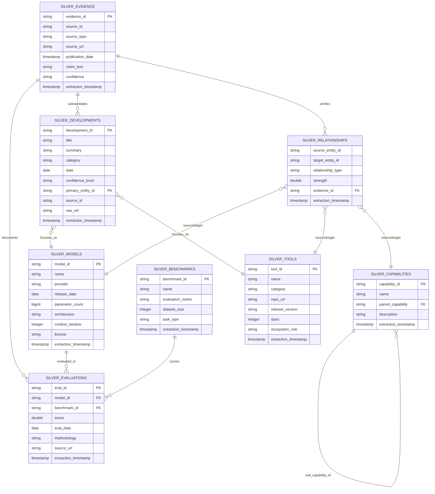

# SIGNAL: AI Landscape Intelligence — Data Schema Architecture

This document defines the complete schema architecture for **SIGNAL**, an AI Landscape Intelligence observatory that tracks the evolution of AI research, models, tools, infrastructure, capabilities, and benchmarks.

The data architecture adheres to the Databricks **Medallion Architecture** (Bronze → Silver → Gold), supporting both local execution via **DuckDB** and enterprise execution via **Databricks Unity Catalog** (`workspace.signal_*`).

---

## 1. Architecture Overview



---

## 2. Entity-Relationship Diagram (Silver Layer)



---

## 3. Bronze Layer: Raw Ingestion

The Bronze layer captures unprocessed event and record payloads directly from external sources. It preserves raw data faithfully without loss.

### 3.1 `bronze_raw_feeds`

| Column | Type | Constraints | Description |
|---|---|---|---|
| `source_id` | VARCHAR(256) | NOT NULL | Stable unique identifier assigned by source (e.g., `arxiv:2412.01234`, `hf:meta-llama/Llama-3.3-70B-Instruct`, `gh:langchain-ai/langgraph:v0.2.60`). |
| `source_type` | VARCHAR(64) | NOT NULL | Source origin: `arxiv`, `huggingface`, `github`, `announcement`, `benchmark_registry`. |
| `payload_json` | TEXT | NOT NULL | Unaltered raw JSON payload from API or scraper. |
| `ingestion_timestamp` | TIMESTAMP | NOT NULL | UTC timestamp when record was appended to Bronze. |
| `content_hash` | VARCHAR(64) | NOT NULL | Canonical SHA-256 hash of payload for idempotent deduplication. |

*Primary Key:* `(source_id, content_hash)`

### 3.2 `bronze_checkpoints`

Tracks polling offsets and ingestion high-water marks for incremental runs.

| Column | Type | Constraints | Description |
|---|---|---|---|
| `feed_name` | VARCHAR(128) | PRIMARY KEY | Unique feed stream name (e.g., `arxiv_cs_ai`, `huggingface_daily`). |
| `last_ingested_at` | TIMESTAMP | NOT NULL | Timestamp of the most recent item ingested from this feed. |
| `record_count` | BIGINT | NOT NULL | Total count of records ingested from this feed. |
| `checkpoint_offset`| VARCHAR(256) | NULL | Cursor token, pagination index, or Git commit SHA. |

---

## 4. Silver Layer: Normalized Knowledge Model

Silver tables enforce data cleanliness, referential integrity, consistent entity schemas, and provenance tracking.

### 4.1 `silver_developments`
Tracks specific technological announcements, publications, and milestone releases.

| Column | Type | Nullable | Description |
|---|---|---|---|
| `development_id` | VARCHAR(128) | NO (PK) | Canonical UUID or prefixed identifier (`dev_2026_...`). |
| `title` | VARCHAR(512) | NO | Concise headline describing the development. |
| `summary` | TEXT | NO | Normalized summary highlighting technical significance. |
| `category` | VARCHAR(64) | NO | Classification: `model_release`, `agent_framework`, `benchmark`, `research_breakthrough`, `infra_tool`. |
| `date` | DATE | NO | Official release, publication, or announcement date. |
| `confidence_level` | VARCHAR(32) | NO | One of: `ANNOUNCEMENT`, `EVALUATED`, `PEER_REVIEWED`, `HYPOTHESIS`, `EMPIRICAL`. |
| `primary_entity_id`| VARCHAR(128) | YES | FK reference to primary model (`model_id`) or tool (`tool_id`). |
| `source_id` | VARCHAR(256) | NO | Source ID corresponding to origin record. |
| `raw_ref` | VARCHAR(64) | NO | Reference to Bronze `content_hash`. |
| `extraction_timestamp` | TIMESTAMP | NO | UTC timestamp when entity was extracted from Bronze. |

### 4.2 `silver_models`
Tracks AI Foundation, Fine-tuned, and Reasoning models.

| Column | Type | Nullable | Description |
|---|---|---|---|
| `model_id` | VARCHAR(128) | NO (PK) | Normalized model slug (e.g., `deepseek-r1`, `claude-3-5-sonnet`, `llama-3-3-70b`). |
| `name` | VARCHAR(256) | NO | Full formal model name (e.g., `DeepSeek R1`, `Llama 3.3 70B Instruct`). |
| `provider` | VARCHAR(128) | NO | Releasing lab or company (`DeepSeek`, `Anthropic`, `Meta`, `Google`, `OpenAI`). |
| `release_date` | DATE | NO | Official general availability or publication date. |
| `parameter_count` | BIGINT | YES | Active parameter count (e.g. 70000000000 for 70B; NULL if undisclosed). |
| `architecture` | VARCHAR(128) | YES | Underlying architecture (`MoE`, `Dense Transformer`, `Hybrid Mamba-Transformer`). |
| `context_window` | INTEGER | YES | Maximum token context window (e.g. 128000, 200000, 1000000). |
| `license` | VARCHAR(128) | NO | `Open Weights / Apache 2.0`, `Proprietary / API`, `Llama 3.3 Community`, etc. |
| `extraction_timestamp` | TIMESTAMP | NO | UTC timestamp when record was parsed. |

### 4.3 `silver_tools`
Tracks developer frameworks, agent runtimes, inference engines, and evaluation harnesses.

| Column | Type | Nullable | Description |
|---|---|---|---|
| `tool_id` | VARCHAR(128) | NO (PK) | Canonical tool slug (e.g., `langgraph`, `vllm`, `autogen`, `dspy`, `crewai`). |
| `name` | VARCHAR(256) | NO | Official framework / tool name. |
| `category` | VARCHAR(64) | NO | `agent_orchestration`, `serving_inference`, `eval_observability`, `prompt_engineering`. |
| `repo_url` | VARCHAR(512) | YES | Canonical code repository URL (GitHub/GitLab). |
| `release_version` | VARCHAR(64) | YES | Latest tracked semantic release tag (e.g. `v0.2.60`). |
| `stars` | INTEGER | YES | GitHub star count or community metric. |
| `ecosystem_role` | VARCHAR(256) | YES | Functional role (e.g., `Multi-Agent Graph Runtime`, `High-Throughput LLM Serving Engine`). |
| `extraction_timestamp` | TIMESTAMP | NO | UTC timestamp when parsed. |

### 4.4 `silver_benchmarks`
Tracks standardized evaluation benchmarks, evaluation metrics, and dataset boundaries.

| Column | Type | Nullable | Description |
|---|---|---|---|
| `benchmark_id` | VARCHAR(128) | NO (PK) | Canonical benchmark slug (e.g., `mmlu_pro`, `swe_bench_verified`, `humaneval`, `gpqa_diamond`). |
| `name` | VARCHAR(256) | NO | Official benchmark title. |
| `evaluation_metric`| VARCHAR(128) | NO | Metric name & unit (e.g. `Accuracy (%)`, `Pass@1 (%)`, `Resolved Rate (%)`). |
| `dataset_size` | INTEGER | YES | Total number of test evaluation items / tasks. |
| `task_type` | VARCHAR(128) | NO | Evaluation domain (`Reasoning & Knowledge`, `Autonomous Software Engineering`, `Code Synthesis`). |
| `extraction_timestamp` | TIMESTAMP | NO | UTC timestamp when benchmark schema was created. |

### 4.5 `silver_evaluations`
Tracks verified model evaluations against standardized benchmarks with explicit methodology preservation.

| Column | Type | Nullable | Description |
|---|---|---|---|
| `eval_id` | VARCHAR(128) | NO (PK) | Unique evaluation observation identifier. |
| `model_id` | VARCHAR(128) | NO (FK) | Reference to `silver_models.model_id`. |
| `benchmark_id` | VARCHAR(128) | NO (FK) | Reference to `silver_benchmarks.benchmark_id`. |
| `score` | DOUBLE | NO | Numeric evaluation score according to benchmark metric. |
| `eval_date` | DATE | NO | Date evaluation was conducted or published. |
| `methodology` | VARCHAR(256) | NO | Evaluation conditions (e.g. `0-shot CoT`, `5-shot direct`, `Scaffolded Agent (Pass@1)`). |
| `source_url` | VARCHAR(512) | NO | URL to technical paper, official blog, or benchmark leaderboard. |
| `extraction_timestamp` | TIMESTAMP | NO | UTC timestamp when evaluation was captured. |

> [!IMPORTANT]
> **Methodology Matching Rule:** Comparing scores across different methodologies (e.g. 0-shot CoT vs 5-shot direct) is strictly invalid. The Gold model comparisons view filters and matches evaluations by normalized methodology.

### 4.6 `silver_capabilities`
A normalized taxonomy of core AI capabilities and reasoning paradigms.

| Column | Type | Nullable | Description |
|---|---|---|---|
| `capability_id` | VARCHAR(128) | NO (PK) | Hierarchical slug (e.g., `cap_reasoning`, `cap_agent_planning`, `cap_code_gen`). |
| `name` | VARCHAR(256) | NO | Capability name. |
| `parent_capability`| VARCHAR(128) | YES (FK) | Recursive foreign key pointing to broader parent capability. |
| `description` | TEXT | YES | Detailed definition of what this capability entails. |
| `extraction_timestamp` | TIMESTAMP | NO | UTC timestamp. |

### 4.7 `silver_relationships`
A directed knowledge graph connecting research papers, models, developer tools, and capabilities.

| Column | Type | Nullable | Description |
|---|---|---|---|
| `source_entity_id` | VARCHAR(128) | NO | Origin entity ID (e.g. `deepseek-r1`, `langgraph`, `arxiv:2412.01234`). |
| `target_entity_id` | VARCHAR(128) | NO | Destination entity ID (e.g. `cap_test_time_compute`, `vllm`). |
| `relationship_type` | VARCHAR(64) | NO | Directed edge type: `implements`, `depends_on`, `evaluates_on`, `improves_upon`, `integrated_with`, `derived_from`. |
| `strength` | DOUBLE | NO | Relationship weight between 0.0 and 1.0. |
| `evidence_id` | VARCHAR(128) | NO (FK) | Pointer to `silver_evidence.evidence_id` verifying the link. |
| `extraction_timestamp` | TIMESTAMP | NO | UTC timestamp. |

### 4.8 `silver_evidence`
Maintains strict scientific and journalistic provenance for every claim, relationship, and benchmark score.

| Column | Type | Nullable | Description |
|---|---|---|---|
| `evidence_id` | VARCHAR(128) | NO (PK) | Unique evidence reference ID. |
| `source_id` | VARCHAR(256) | NO | Source identifier (arXiv ID, GitHub release tag, web announcement). |
| `source_type` | VARCHAR(64) | NO | `arxiv`, `huggingface`, `github`, `official_announcement`, `independent_eval`. |
| `source_url` | VARCHAR(512) | NO | Direct web link to the canonical source artifact. |
| `publication_date` | TIMESTAMP | YES | Publication or release timestamp as reported by source. |
| `claim_text` | TEXT | NO | Extracted verbatim claim or synthesized finding. |
| `confidence` | VARCHAR(32) | NO | Confidence level: `ANNOUNCEMENT`, `EVALUATED`, `PEER_REVIEWED`, `HYPOTHESIS`, `EMPIRICAL`. |
| `extraction_timestamp` | TIMESTAMP | NO | Ingestion/extraction timestamp. |

---

## 5. Gold Layer: Analytical Views & Aggregations

Gold views provide application-ready, denormalized, and aggregated datasets ready for consumption by user interfaces and Databricks Genie.

### 5.1 `v_recent_developments`
Filters and joins developments from the last 30 days with evidence attribution and primary entity details.

```sql
SELECT 
    d.development_id,
    d.title,
    d.summary,
    d.category,
    d.date,
    d.confidence_level,
    d.primary_entity_id,
    COALESCE(m.name, t.name, d.primary_entity_id) AS primary_entity_name,
    CASE 
        WHEN m.model_id IS NOT NULL THEN 'model'
        WHEN t.tool_id IS NOT NULL THEN 'tool'
        ELSE 'general'
    END AS primary_entity_type,
    e.source_type,
    e.source_url,
    e.claim_text,
    d.extraction_timestamp
FROM silver_developments d
LEFT JOIN silver_evidence e ON d.source_id = e.source_id
LEFT JOIN silver_models m ON d.primary_entity_id = m.model_id
LEFT JOIN silver_tools t ON d.primary_entity_id = t.tool_id
WHERE d.date >= CURRENT_DATE - INTERVAL 30 DAYS
ORDER BY d.date DESC;
```

### 5.2 `v_model_comparisons`
Normalizes benchmark evaluations for apples-to-apples model comparisons. Provides both tabular cross-comparison and methodology matching.

```sql
SELECT
    m.model_id,
    m.name AS model_name,
    m.provider,
    m.release_date,
    m.parameter_count,
    m.architecture,
    m.context_window,
    m.license,
    b.benchmark_id,
    b.name AS benchmark_name,
    b.task_type,
    b.evaluation_metric,
    ev.score,
    ev.methodology,
    ev.eval_date,
    ev.source_url
FROM silver_models m
JOIN silver_evaluations ev ON m.model_id = ev.model_id
JOIN silver_benchmarks b ON ev.benchmark_id = b.benchmark_id;
```

### 5.3 `v_ecosystem_relationships`
Represents the connected graph of AI entities, joining edge relationships with source and target entity metadata and verifying evidence.

```sql
SELECT
    r.source_entity_id,
    COALESCE(sm.name, st.name, sc.name, r.source_entity_id) AS source_entity_name,
    CASE 
        WHEN sm.model_id IS NOT NULL THEN 'model'
        WHEN st.tool_id IS NOT NULL THEN 'tool'
        WHEN sc.capability_id IS NOT NULL THEN 'capability'
        ELSE 'external'
    END AS source_type,
    r.relationship_type,
    r.target_entity_id,
    COALESCE(tm.name, tt.name, tc.name, r.target_entity_id) AS target_entity_name,
    CASE 
        WHEN tm.model_id IS NOT NULL THEN 'model'
        WHEN tt.tool_id IS NOT NULL THEN 'tool'
        WHEN tc.capability_id IS NOT NULL THEN 'capability'
        ELSE 'external'
    END AS target_type,
    r.strength,
    r.evidence_id,
    ev.source_url,
    ev.claim_text,
    ev.confidence
FROM silver_relationships r
LEFT JOIN silver_models sm ON r.source_entity_id = sm.model_id
LEFT JOIN silver_tools st ON r.source_entity_id = st.tool_id
LEFT JOIN silver_capabilities sc ON r.source_entity_id = sc.capability_id
LEFT JOIN silver_models tm ON r.target_entity_id = tm.model_id
LEFT JOIN silver_tools tt ON r.target_entity_id = tt.tool_id
LEFT JOIN silver_capabilities tc ON r.target_entity_id = tc.capability_id
LEFT JOIN silver_evidence ev ON r.evidence_id = ev.evidence_id;
```

### 5.4 `v_agent_trends`
Aggregates rolling 30-day velocity, tool development momentum, and ecosystem activity for autonomous agent frameworks.

```sql
WITH agent_devs AS (
    SELECT 
        primary_entity_id AS tool_id,
        COUNT(*) AS recent_developments_count,
        MAX(date) AS latest_development_date
    FROM silver_developments
    WHERE category = 'agent_framework'
      AND date >= CURRENT_DATE - INTERVAL 30 DAYS
    GROUP BY primary_entity_id
),
agent_relations AS (
    SELECT 
        source_entity_id AS tool_id,
        COUNT(*) AS integration_count
    FROM silver_relationships
    WHERE relationship_type IN ('depends_on', 'integrated_with', 'implements')
    GROUP BY source_entity_id
)
SELECT 
    t.tool_id,
    t.name,
    t.category,
    t.release_version,
    t.stars,
    t.ecosystem_role,
    COALESCE(d.recent_developments_count, 0) AS developments_last_30d,
    COALESCE(r.integration_count, 0) AS total_integrations,
    ROUND(
        (COALESCE(t.stars, 0) / 1000.0) * 0.4 + 
        (COALESCE(d.recent_developments_count, 0) * 15.0) + 
        (COALESCE(r.integration_count, 0) * 5.0), 
        2
    ) AS momentum_score,
    CASE 
        WHEN COALESCE(d.recent_developments_count, 0) >= 3 THEN 'ACCELERATING'
        WHEN COALESCE(d.recent_developments_count, 0) >= 1 THEN 'STEADY'
        WHEN t.stars > 10000 THEN 'MATURE'
        ELSE 'EMERGING'
    END AS velocity_category
FROM silver_tools t
LEFT JOIN agent_devs d ON t.tool_id = d.tool_id
LEFT JOIN agent_relations r ON t.tool_id = r.tool_id
WHERE t.category IN ('agent_orchestration', 'serving_inference');
```

---

## 6. Incremental Ingestion & Deduplication Rules

1. **Content Hashing:** Bronze ingestion calculates the SHA-256 digest of normalized payload JSON (`content_hash = sha256(canonical_json(payload))`). If `(source_id, content_hash)` already exists in `bronze_raw_feeds`, the record is skipped without reprocessing.
2. **Version Preservation:** When a tool releases a new version or a model's benchmarks are updated, a new record is created in Bronze with a new content hash. The Silver layer updates or records a new version with the new `extraction_timestamp`, while historical records remain queryable.
3. **Reference Validation:** During Silver transformation, all foreign key pointers (`primary_entity_id`, `model_id`, `benchmark_id`, `evidence_id`) are validated. Orphaned records are routed to an audit quarantine log.
4. **Methodology Matching:** Silver benchmark records mandate explicit methodology labels (`0-shot CoT`, `5-shot`, etc.). No Gold comparison view aggregates scores across mismatched methodology types.
5. **Confidence Hierarchy:** All claims are tagged with one of:
   `PEER_REVIEWED` > `EVALUATED` > `EMPIRICAL` > `ANNOUNCEMENT` > `HYPOTHESIS`.
